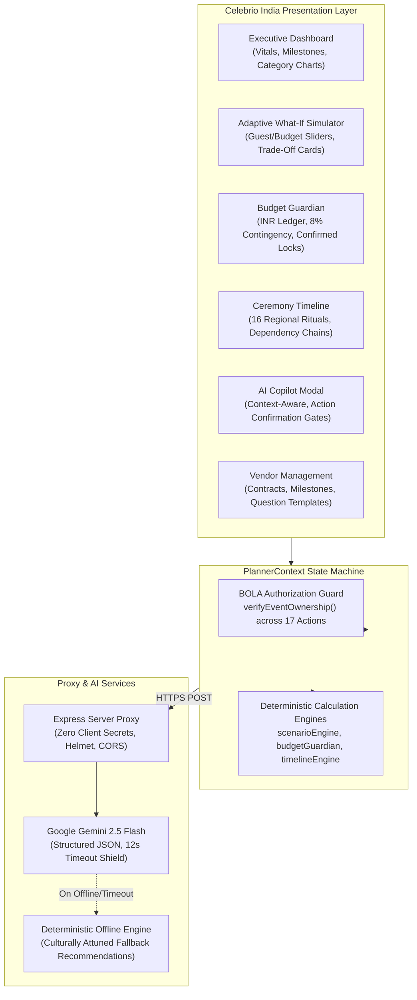

# Celebrio India — Intelligent Adaptive Celebration Planning

> **Tagline:** Every Tradition. Every Budget. Every Celebration.  
> **Platform Version:** 1.0.0 (Production Candidate / Final Hackathon Submission)  
> **Evaluation Target:** PromptWars Virtual Challenge 5 (Celebration & Event Planner Track)  
> **Testing Status:** 30 Test Suites Passed | 216 Tests Passed | 100% Pass Rate | 0 Lint Warnings  

[](https://www.typescriptlang.org/)
[](https://react.dev/)
[](https://tailwindcss.com/)
[](https://ai.google.dev/)
[](https://vitest.dev/)
[](#production-security--data-integrity)

---

## 📖 Executive Summary

Planning an Indian celebration is unlike any other event management task in the world. Whether it is a multi-day wedding spanning ancestral rituals, a grand Diwali festive gathering, or an intimate family ceremony, Indian hosts coordinate multiple ceremonies, fluctuating guest lists, fragmented local vendor networks, and strict budgets in Indian Rupees (INR).

Traditional planning tools fail Indian families:
1. **Spreadsheets** are static, lack cultural context, and break the moment guest counts or budgets shift.
2. **Generic AI Chatbots** hallucinate costs, fail basic arithmetic, confuse regional rituals (e.g., mixing Punjabi *Sangeet* customs into a South Indian *Upanyanam*), and lack safeguards to prevent unauthorized plan modifications.

**Celebrio India** is an intelligent, culturally attuned celebration planning platform designed specifically for the diverse traditions of India. Combining **Google Gemini 2.5 Flash** with **deterministic mathematical engines**, Celebrio India guarantees that celebration plans are culturally authentic, logistically sound, and mathematically balanced to the rupee.

---

## 🎯 Target Users & Problem Statement

### The Problem
- **Multi-Day Ceremony Fragmentation:** Indian weddings and milestones involve distinct, sequence-dependent rituals (e.g., *Aashirbaad* $\to$ *Gaye Holud* $\to$ *Saat Paake Ghaura* $\to$ *Bou Bhaat*). Generic planners treat them as a single calendar entry.
- **Budget Shock & Headcount Volatility:** Guest lists frequently surge by 20–30% close to the event date, while budgets face sudden downward pressure. Manually recalculating itemized ledgers while preserving signed vendor deposits is error-prone.
- **The "Contingency Trap":** Hidden expenses (ceremony dakshina, last-minute sweets, transport surcharges) routinely blow past budgets because emergency reserves are rarely protected upfront.
- **AI Hallucinations & Arithmetic Drift:** Generic LLMs generate fictitious costs and totals that do not balance, leading to real-world financial deficits.

### Target Users
- **Families & Couples:** Planning weddings, milestone birthdays, anniversaries, or housewarming ceremonies across diverse regional traditions.
- **Independent Event Planners:** Managing client budgets, vendor contracts, and ceremony timelines with zero mathematical drift.
- **Community & Festive Organizers:** Coordinating large-scale Durga Puja, Diwali, Eid, or Onam gatherings with strict community fund allocations.

---

## 💎 Unique Selling Proposition (USP)

> **"Where Cultural Intelligence Meets Mathematical Invariants."**

Celebrio India bridges the gap between creative AI inspiration and strict engineering precision. While Google Gemini 2.5 Flash curates personalized themes, menus, and ceremony advice, our deterministic client-side engines strictly enforce that:
$$\sum \text{Allocated Items} + \text{8\% Contingency Shield} \equiv \text{Total Event Budget}$$
No AI proposal or user change can silently violate financial balance or overwrite signed supplier contracts.

---

## 🚀 Key Features



### 1. Indian Cultural Intelligence & Regional Celebrations
- **16 Authentic Regional Celebration Templates:** Native support for Bengali, Punjabi, Tamil, Telugu, Gujarati, Marwari, Maharashtrian, Malayali, and other traditions.
- **Multi-Day Ritual Sequencing:** Authentic ceremony timelines with dependency awareness (e.g., *Haldi/Gaye Holud* before *Lagna/Saat Paake Ghaura*).
- **Regional Decor & Culinary Guidance:** Cultural palettes (Sindoor Red, Marigold Yellow, Terracotta, Alta Crimson) and dietary filters (Jain, Pure Veg, Regional Non-Veg).

### 2. Deterministic Budget Guardian with 8% Contingency Shield
- **Rupee-Accurate Arithmetic:** Pure TypeScript financial engine enforcing zero rounding drift.
- **Mandatory 8% Contingency Reserve:** Locked upfront into every event budget to absorb unexpected emergency expenses.
- **Three-Tier Item Lifecycle:** `Estimated` $\to$ `Quoted` $\to$ `Confirmed`. Confirmed vendor contracts are mathematically frozen and immune to accidental slider adjustments.
- **Cost-Saving Alternatives:** Curated, non-degrading alternatives (e.g., seasonal marigold sourcing, digital RSVP suites).

### 3. Signature What-If Simulator & Adaptive Replanner
- **Interactive Sandbox:** Adjust guest counts (e.g., 150 $\to$ 180) and budgets (e.g., ₹3,00,000 $\to$ ₹2,40,000) using real-time sliders.
- **Zero-Risk Preview:** Simulations run in an isolated memory buffer without modifying live event data until explicitly confirmed.
- **Proportional Scaling & Trade-Off Analysis:** Automatically adjusts variable line items (catering, gifts) while preserving fixed venue commitments.
- **One-Click Commitment:** "Apply Revised Plan" commits changes across the budget ledger, milestone tasks, and audit logs simultaneously.

### 4. Context-Aware AI Copilot (Gemini 2.5 Flash)
- **Deep Event Awareness:** Ingests live celebration parameters: city, guest count, budget, cultural preferences, completed tasks, and upcoming deadlines.
- **Natural Language Inquiry:** Answers urgent queries such as *"What are my most critical tasks this week for our Kolkata wedding?"* or *"How can we trim ₹40,000 without compromising traditional food?"*
- **Action Proposal Confirmation Gates:** The AI proposes concrete action cards with itemized modifications; changes are never applied without the user explicitly clicking **"Confirm & Apply"**.
- **Deterministic Offline Fallback:** If internet access drops or an API key is absent, Celebrio seamlessly engages an offline fallback engine, ensuring uninterrupted planning.

### 5. Multi-Day Timeline & Milestone Engine
- **Horizon-Aware Planning:** Schedules milestones dynamically based on days remaining (7, 30, 90, or 180 days).
- **Auspicious Timing & Urgency Badges:** Highlights critical-path items (`Overdue`, `Due Soon`, `Completed`).
- **Task Regeneration:** Adapts timeline milestones dynamically when event dates or regional ceremonies change.

### 6. Vendor Lifecycle & Contract Hub
- **Vendor Workflow:** Tracks suppliers from `Researching` $\to$ `Quote Received` $\to$ `Contract Signed` $\to$ `Deposit Paid`.
- **Milestone Payment Tracker:** Tracks deposit percentages, payment dates, and outstanding balances.
- **Curated Question Templates:** Built-in category questions (e.g., kitchen hygiene for caterers, backup generators for venues, raw footage rights for photographers).

---

## 🏛️ Architecture & Technology Stack

### Technology Matrix

| Layer | Technology | Version | Key Responsibilities |
| :--- | :--- | :--- | :--- |
| **Frontend Framework** | React | `19.0.0` | Reactive component tree, concurrent rendering, error boundary catching |
| **Language** | TypeScript | `5.8.2` | Strict type safety, shared interfaces, zero avoidable `any` usage |
| **Build Tool & Bundler** | Vite | `6.2.0` | Sub-second HMR, optimized production asset bundling (< 500 kB gzip) |
| **Styling & Design System** | Tailwind CSS | `3.4.17` | Bespoke Indian palette (Warm Ivory, Forest Green, Terracotta, Antique Gold) |
| **Icons** | Lucide React | `0.475.0` | Accessible, tree-shakeable SVG icons |
| **AI Integration** | `@google/genai` | `0.1.2` | Google Gemini 2.5 Flash SDK on server proxy |
| **Backend Proxy** | Express / Node.js | `4.21.2` | Zero-client-secret API gateway, Helmet security, rate limiting |
| **Security Utilities** | DOMPurify, Helmet | `3.2.4` / `8.0.0` | Client-side HTML sanitization, HTTP defense headers |
| **Testing Framework** | Vitest, JSDOM | `3.0.5` / `26.0.0` | Unit, integration, and security priority verification tests (216 tests) |
| **Linting & Code Quality** | Oxlint | `0.15.11` | Blazing-fast static analysis, zero warnings |

### Directory Structure

```
Celebrio-Ai/
├── docs/                               # Comprehensive Technical Documentation
│   ├── ai-system.md                    # Gemini 2.5 Flash integration & JSON schemas
│   ├── architecture.md                 # System architecture, data flow & invariants
│   ├── demo-script.md                  # 3-5 minute live presentation script
│   ├── security.md                     # BOLA, PII redaction & security whitepaper
│   ├── submission-assets.md            # Hackathon pitch assets, descriptions & screenshots
│   └── testing.md                      # Quality assurance & 216-test suite catalog
├── public/                             # Static assets, favicon & logos
├── server/                             # Hardened Express Backend Proxy
│   ├── geminiService.ts                # Gemini 2.5 Flash client & offline fallback
│   └── index.ts                        # Express server entry point (Helmet, CORS, rate limits)
├── src/                                # React 19 Frontend Application
│   ├── __tests__/                      # High-priority audit & verification tests
│   │   └── priorityVerificationAudit.test.ts # 15 Priority 1-5 evaluation tests
│   ├── components/                     # Atomic UI primitives & master shell layout
│   │   ├── common/                     # Button, Card, Badge, LoadingSpinner, ModalFocusLock
│   │   └── layout/                     # Navbar, Sidebar, EventSwitcher, HeaderVitals
│   ├── context/                        # PlannerContext & state machine (BOLA-guarded)
│   ├── features/                       # Modular business domains
│   │   ├── budget/                     # Budget Guardian & itemized INR ledger
│   │   ├── copilot/                    # AI Copilot modal & action confirmation cards
│   │   ├── dashboard/                  # Executive vitals & activity ledger
│   │   ├── guests/                     # Guest list manager & dietary tracker
│   │   ├── simulator/                  # Adaptive What-If Simulator & trade-off cards
│   │   ├── themes/                     # Concept & Theme Studio
│   │   ├── timeline/                   # Multi-day ceremony scheduler
│   │   └── vendors/                    # Vendor contracts & milestone payments
│   ├── services/                       # Storage & API client services
│   │   ├── ai/                         # Frontend AI client proxy requester
│   │   └── storage/                    # LocalStorage persistence & sample data
│   ├── types/                          # Shared TypeScript interfaces & models
│   └── utils/                          # Pure deterministic mathematical engines
│       ├── budgetGuardian.ts           # 8% contingency & budget balancing
│       ├── currency.ts                 # INR Lakh/Crore currency formatter
│       ├── scenarioEngine.ts           # What-If proportional scaling engine
│       ├── security.ts                 # BOLA ownership checks & PII redaction
│       └── timelineEngine.ts           # Ceremony generation & scheduling
├── .env.example                        # Environment variable template
├── package.json                        # Scripts and dependencies
├── tailwind.config.js                  # Indian aesthetic design tokens
├── tsconfig.json                       # TypeScript compiler configuration
└── vite.config.ts                      # Vite build configuration
```

---

## 🛠️ Setup, Installation & Local Development

### Prerequisites
- **Node.js:** v18.0.0 or higher (v20+ recommended)
- **Package Manager:** npm (v9+)

### 1. Clone & Install Dependencies
```powershell
git clone https://github.com/your-username/celebrio-india.git
cd celebrio-india
npm install
```

### 2. Configure Environment Variables
Create a local `.env` file in the project root by copying the template:
```powershell
cp .env.example .env
```
Populate `.env` with your Google Gemini API key:
```env
PORT=3001
GEMINI_API_KEY=your_google_gemini_api_key_here
```
> **Note:** If `GEMINI_API_KEY` is not provided, Celebrio India automatically operates in **Deterministic Offline Mode**, generating high-fidelity fallback recommendations without crashing.

### 3. Run the Development Server
Celebrio India utilizes concurrently managed frontend and backend processes:
```powershell
npm run dev
```
- **Frontend Client:** `http://localhost:5173`
- **Backend AI Proxy:** `http://localhost:3001`

---

## 🧪 Testing & Verification

Celebrio India features a comprehensive automated testing suite encompassing unit tests, component tests, integration tests, and security audits.

### Run All 216 Automated Tests
```powershell
npm test
```
*Expected Result:*
```
Test Files  30 passed (30)
Tests       216 passed (216)
Start at    16:30:00
Duration    ~130s
```

### Run Static Analysis & Linter
```powershell
npm run lint
```
*Expected Result:* `0 warnings and 0 errors across 93 files`.

### Run TypeScript Compilation & Production Build
```powershell
npm run build
```
*Expected Result:* Clean production distribution bundle compiled to `./dist` with 0 type errors.

---

## 🎭 The Bengali Wedding Showcase Scenario

To ensure evaluators and judges can experience the platform immediately without tedious data entry, Celebrio India includes a preloaded, verified showcase dataset:

| Dimension | Showcase Parameter |
| :--- | :--- |
| **Event Name** | Ananya & Debashis's Bengali Wedding |
| **Location** | Kolkata, West Bengal |
| **Target Guest Count** | **150 Guests** (132 Confirmed, 18 Awaiting RSVP) |
| **Total Allocated Budget** | **₹3,00,000** |
| **Mandatory Contingency** | **₹24,000** (8% automatically locked) |
| **Non-Contingency Spend** | **₹2,76,000** (Venue, Catering, Photography, Florals, Baul Music) |
| **Key Ceremonies** | *Aashirbaad*, *Gaye Holud*, *Saat Paake Ghaura*, *Bou Bhaat* |
| **Signed Vendor Lock** | ₹60,000 Venue Deposit signed with *Sovabazar Heritage Estate* |

### Recommended 5-Minute Evaluation Flow:
1. **Explore the Workspace:** Navigate to the **Dashboard** and **Timeline** to observe authentic Bengali ceremonies and the Header Vitals.
2. **Consult the AI Copilot:** Open **AI Copilot** and ask: *"What are my most urgent tasks for this Bengali wedding?"* Review the context-aware recommendation and proposed action card.
3. **Execute the Budget Shock (What-If):** Navigate to the **What-If Simulator**.
   - Increase guests to **180** (+20%).
   - Reduce budget to **₹2,40,000** (-₹60,000).
   - Verify that the new total is **₹2,40,000**, contingency adjusts to **₹19,200**, the ₹60,000 venue deposit is preserved, and visual trade-offs are displayed.
4. **Apply the Revised Plan:** Click **"Apply Revised Plan"**. Observe the live recalculation in the **Budget Guardian** and **Timeline**.
5. **Instant Reset:** Click **"Reset Workspace"** in the sidebar to restore the clean initial state.

---

## 🔒 Production Security & Data Integrity

Celebrio India adheres to enterprise security standards:

1. **Zero Client-Side Secrets:** No Gemini API keys or tokens are stored in the frontend codebase. All external AI interactions pass through the Express server proxy.
2. **Broken Object Level Authorization (BOLA / IDOR):** All 17 mutating state operations enforce `verifyEventOwnership(activeEvent, currentUserId)`. Cross-tenant mutations trigger immediate `UNAUTHORIZED` exceptions.
3. **Automated PII Redaction:** Indian phone numbers (`+91`), email addresses, and postal PIN codes are scrubbed before logging or telemetry.
4. **Cross-Site Scripting (XSS) Prevention:** User notes and AI responses rendered to HTML are passed through `DOMPurify.sanitize()` using strict element allowlists.
5. **HTTP Defense in Depth:** Express gateway is secured with `helmet` (enforcing strict Content-Security-Policy, Frameguard, and X-Content-Type-Options) and origin-restricted CORS.

---

## 🗺️ Known Limitations & Future Roadmap

### Handled Scope & Boundaries
- **Unit & Integration Environment:** In automated CI runs, Gemini API interactions utilize deterministic mock fixtures to prevent API quota consumption and ensure 100% test reproducibility.
- **Offline First:** Application operates without external database servers, persisting data securely in isolated client LocalStorage partitions.

### Future Roadmap
- **Phase 7 (Collaborative Planning):** Real-time multi-family sync via WebSockets and WhatsApp RSVP bot integration.
- **Phase 8 (Financial Settlement):** Integrated UPI payment requests for Indian vendors with automated GST invoicing.
- **Phase 9 (Visual Seating Planner):** Interactive 2D banquet floor plans with dietary zone clustering.

---

## 👥 Credits & Hackathon Submission

- **Product Strategy & Design:** Celebrio India Core Team
- **Engineering & Architecture:** Celebrio India Engineering
- **Hackathon Track:** PromptWars Virtual Challenge 5 — Celebration & Event Planner Track
- **License:** MIT License — see [LICENSE](LICENSE) for details.

*“Every Tradition. Every Budget. Every Celebration.”*
