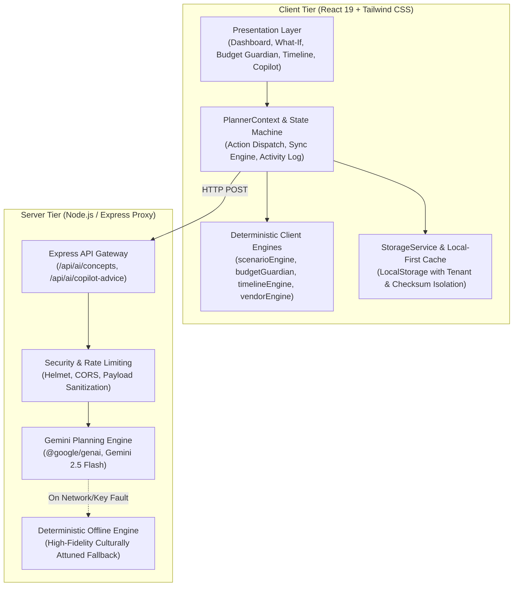
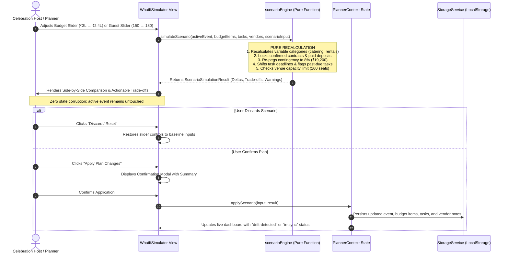

# Celebrio India — System Architecture & Technical Specifications

> **Tagline:** Every Tradition. Every Budget. Every Celebration.  
> **Platform Version:** 1.0.0 (Production / Hackathon Candidate)  
> **Evaluation Target:** PromptWars Virtual Challenge 5  

---

## 1. High-Level Architecture Overview

Celebrio India is engineered as an intelligent, responsive, local-first celebration planning platform powered by a server-side Generative AI proxy. It provides end-to-end event lifecycle management tailored specifically to the cultural, logistical, and financial requirements of Indian celebrations.

---

## 2. Frontend Architecture

### 2.1 Component & Layer Hierarchy
The frontend adheres to strict domain separation between presentation, state orchestration, and pure mathematical calculation:
- **`src/components/common/`:** Headless and styled atomic UI primitives (`Button`, `Card`, `Badge`, `LoadingSpinner`, `ModalFocusLock`).
- **`src/components/layout/`:** Master shell components (`Navbar`, `Sidebar`, `EventSwitcher`, `HeaderVitals`).
- **`src/features/`:** Self-contained business domains:
  - `dashboard/`: Executive vitals, countdown clock, category distribution charts, and recent activity audit feed.
  - `simulator/`: Adaptive What-If Simulator with side-by-side comparison tables, visual trade-off cards, and explicit plan application modals.
  - `budget/`: Itemized INR ledger, 8% contingency reserve shield, status filters (`Estimated`, `Quoted`, `Confirmed`), and cost-saving alternatives.
  - `timeline/`: Multi-day ceremony scheduler, planning horizon indicators, dependency tracking, and deadline cascades.
  - `vendors/`: Supplier comparison worksheets, contract lifecycle tracking, and payment milestone schedules.
  - `copilot/`: Natural language celebration advisor with quick prompt shortcuts and structured action proposals.
  - `events/`: Multi-category event creation wizard with 16 regional Indian cultural preferences.
  - `settings/`: Manifest export/import, tenant switching, and instant showcase data reset.

### 2.2 State Management
State is orchestrated through a central, strongly typed React Context (`PlannerContext`):
- **Predictable Mutations:** All entity mutations (`addBudgetItem`, `applyScenario`, `updateTaskStatus`, `addVendor`, `updateActiveEvent`) go through validated callbacks.
- **Strict Authorization:** Every mutating operation validates object ownership using `verifyEventOwnership(activeEvent, currentUserId)`.
- **Bidirectional Synchronization:** Changes to vendor quotes automatically synchronize to linked budget items; timeline date changes automatically shift preparation milestones.

---

## 3. Backend Architecture

### 3.1 Node.js / Express Proxy Layer
To ensure complete secret safety and zero client-side exposure of API keys, the application routes all GenAI requests through an Express backend:
- **`server/index.ts`:** Express application entry point configuring HTTP headers, body parsing, and routing.
- **`server/apiHandler.ts`:** REST endpoint definitions:
  - `POST /api/ai/concepts`: Generates 3 personalized celebration theme concepts.
  - `POST /api/ai/copilot-advice`: Produces context-aware strategic and urgent task explanations.
  - `GET /api/ai/health`: Real-time Gemini API connectivity check.
- **`server/geminiService.ts`:** Service handling prompt construction, Gemini 2.5 Flash invocation, JSON schema cleanup, and structured action generation.
- **`server/validator.ts`:** Strict input payload validation ensuring non-empty titles, valid INR budgets, and safe guest bounds.

### 3.2 Resilience & Deterministic Fallback
If the server is started without a `GEMINI_API_KEY`, if rate limits are exceeded, or if external network timeouts occur:
- The backend seamlessly transitions to a deterministic rule engine (`getDeterministicAdvice()`).
- Returns rich, culturally authentic advice specifically tailored to Indian celebrations (e.g. Bengali weddings in Kolkata, Tamil muhurats, Punjabi sangeet coordination) without breaking the user experience.

---

## 4. Database & Storage Structure

Celebrio India utilizes a **Local-First Storage Architecture** implemented via `src/services/storage/storageService.ts`. This provides zero-latency interactions, complete offline availability, and privacy-preserving data isolation:

| Storage Key | Schema Type | Description |
| :--- | :--- | :--- |
| `celebrio_events_v2` | `CelebrationEvent[]` | Collection of all celebration plans owned by the client. |
| `celebrio_active_event_id_v2` | `string` | ID of the currently active celebration plan. |
| `celebrio_budget_items_v2` | `BudgetItem[]` | Master itemized expense ledger isolated per `eventId`. |
| `celebrio_tasks_v2` | `TimelineTask[]` | Milestone tasks, dependencies, and deadlines per `eventId`. |
| `celebrio_vendors_v2` | `Vendor[]` | Supplier contracts, quotes, milestones, and questions per `eventId`. |
| `celebrio_guests_v2` | `Guest[]` | Attendee rosters, RSVP statuses, plus-ones, and dietary tags. |
| `celebrio_activities_v2` | `ActivityLogItem[]` | 30-item rolling FIFO audit trail of user and AI decisions. |
| `celebrio_concepts_v2` | `Record<string, ThemeConcept[]>` | Cached personalized concepts per `eventId`. |

---

## 5. What-If Processing Pipeline

The signature capability of Celebrio India is its **Adaptive What-If Recalculation Engine**:

---

## 6. Mathematical Invariants Enforced

1. **Total Budget Invariance:**
   $$\text{Total Required} = \text{Planned Expenditure} + \text{Contingency Reserve}$$
2. **Remaining Balance Invariance:**
   $$\text{Remaining Balance} = \text{Total Spending Cap} - (\text{Planned Expenditure} + \text{Contingency Reserve})$$
3. **Mandatory Contingency Shield:**
   $$\text{Target Contingency Reserve} = \text{round}(\text{Proposed Budget} \times 0.08)$$
4. **Decision Protection Invariant:**
   $$\text{item.costStatus} == \text{'confirmed'} \implies \text{item.allocatedAmount is Immutable by What-If}$$

