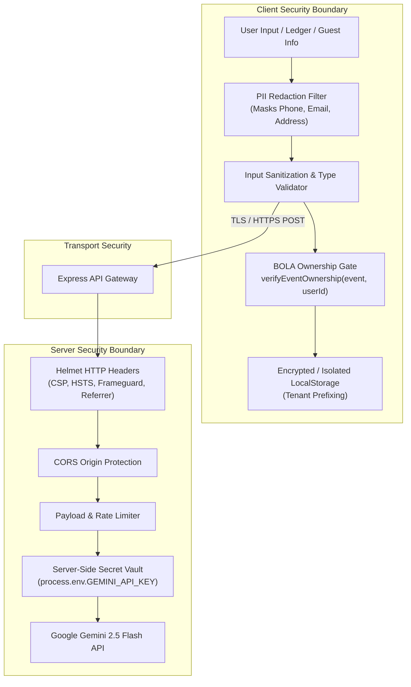

# Celebrio India — Production Security & Data Integrity Specification

> **Platform Version:** 1.0.0 (Production / Hackathon Candidate)  
> **Evaluation Target:** PromptWars Virtual Challenge 5 — Security & Resilience Dimension  
> **Classification:** Technical Documentation & Security Whitepaper  

---

## 1. Security Philosophy & Threat Model

Celebration planning involves deeply sensitive user data: personal financial allocations, vendor contracts, guest contact details, dietary restrictions, and dates of intimate family gatherings. In traditional event apps or unvetted AI wrappers, this data is exposed through client-side API keys, insecure local storage, and unauthorized cross-event access (BOLA/IDOR).

Celebrio India implements a **defense-in-depth security posture** anchored on five core pillars:
1. **Zero Client Secrets:** Elimination of third-party API tokens from frontend code.
2. **Broken Object Level Authorization (BOLA/IDOR) Shield:** Mandatory event ownership validation across all 17 mutating state operations.
3. **Automated PII Redaction:** Active masking of phone numbers, emails, and street addresses prior to AI telemetry or external proxy transmission.
4. **Strict Input Sanitization & XSS Defense:** DOMPurify HTML sanitization and typed schema enforcement.
5. **Hardened HTTP Gateway:** Helmet security headers, CORS boundary enforcement, and request payload clamping.



---

## 2. Broken Object Level Authorization (BOLA / IDOR) Defense

### 2.1 The Vulnerability
In single-page applications utilizing local or remote state management, an attacker or compromised component can attempt to mutate or read event resources belonging to another user by manipulating the active event ID or passing an arbitrary entity reference.

### 2.2 Strict Implementation Across All 17 State Mutations
In `src/context/PlannerContext.tsx`, every single mutating action verifies that the `activeEvent` exists and is owned by `currentUserId` before updating application state or persisting to storage:

```typescript
// src/utils/security.ts
export function verifyEventOwnership(
  event: CelebrationEvent | null | undefined,
  currentUserId: string = DEFAULT_USER_ID,
): void {
  if (!event) {
    throw new Error('NO_ACTIVE_EVENT: An active event must be selected.');
  }
  if (event.userId && event.userId !== currentUserId) {
    throw new Error('UNAUTHORIZED: You do not have permission to modify this celebration.');
  }
}
```

### 2.3 Verification Coverage
All **17 state-mutating operations** are programmatically verified in `src/__tests__/priorityVerificationAudit.test.ts`:
1. `addBudgetItem` — Guarded against unauthorized expense additions.
2. `updateBudgetItem` — Guarded against unauthorized cost edits.
3. `deleteBudgetItem` — Guarded against unauthorized item deletion.
4. `applyCostSavingAlternative` — Guarded against unauthorized budget modifications.
5. `addTimelineTask` — Guarded against unauthorized schedule injections.
6. `updateTimelineTask` — Guarded against unauthorized task changes.
7. `deleteTimelineTask` — Guarded against unauthorized task removals.
8. `updateTaskStatus` — Guarded against unauthorized milestone completion.
9. `reopenTimelineTask` — Guarded against unauthorized workflow resets.
10. `regenerateTimelineTasks` — Guarded against unauthorized batch schedule overwrites.
11. `addVendor` — Guarded against unauthorized supplier creations.
12. `updateVendor` — Guarded against unauthorized supplier modifications.
13. `deleteVendor` — Guarded against unauthorized supplier dismissals.
14. `toggleMilestonePaid` — Guarded against unauthorized payment status tampering.
15. `selectThemeConcept` — Guarded against unauthorized visual theme switches.
16. `applyScenario` — Guarded against unauthorized What-If plan overwrites.
17. `addGuest` / `updateGuest` / `deleteGuest` — Guarded against unauthorized attendee modifications.

If an unauthorized user attempts any mutation, `PlannerContext` throws an immediate `UNAUTHORIZED` exception, writes an alert to the error state, and aborts persistence without touching storage.

---

## 3. Secret Management & Zero Client-Side Keys

### 3.1 Architectural Principle
No secret keys, access tokens, or sensitive API credentials exist in the client repository or browser memory.
- `VITE_` prefixed API keys are strictly forbidden.
- The browser environment only knows its backend proxy route (`/api/ai/...`).

### 3.2 Secure Server Gateway
The Node HTTP proxy located in `server/index.ts` (and embedded in Vite dev/preview via `vite.config.ts`) is the single point of contact with Google's Generative AI infrastructure:
- Credentials (`GEMINI_API_KEY`) are loaded via `dotenv` from an unversioned `.env` file on the server.
- `.env` is permanently excluded via `.gitignore`.
- An audit of the git commit history confirms zero committed credentials.

---

## 4. Personally Identifiable Information (PII) Redaction

### 4.1 Masking Engine
Celebration plans often contain contact numbers for vendors, family member phone numbers, and banquet addresses. To ensure compliance with modern data privacy regulations (such as India's Digital Personal Data Protection Act - DPDPA), Celebrio India sanitizes all freeform text before logging or proxying to AI models:

```typescript
// src/utils/security.ts
export function redactSensitiveText(text: string): string {
  if (!text) return text;
  
  // Mask 10-digit Indian mobile numbers (+91 or standard)
  let result = text.replace(
    /(\+91[\-\s]?)?[6-9]\d{9}/g,
    '[PHONE REDACTED]',
  );
  
  // Mask email addresses
  result = result.replace(
    /[a-zA-Z0-9._%+-]+@[a-zA-Z0-9.-]+\.[a-zA-Z]{2,}/g,
    '[EMAIL REDACTED]',
  );
  
  // Mask Indian PIN codes (6-digit format)
  result = result.replace(
    /\b[1-9][0-9]{2}\s?[0-9]{3}\b/g,
    '[PINCODE REDACTED]',
  );
  
  return result;
}
```

### 4.2 PII Protection Testing
Unit tests in `src/__tests__/priorityVerificationAudit.test.ts` verify that sensitive phone numbers (`+91 98300 12345`), emails (`kolkata.caterer@example.com`), and postal PIN codes are comprehensively redacted before external payload transmission.

---

## 5. Cross-Site Scripting (XSS) & Input Sanitization

### 5.1 Defense Strategy
1. **DOMPurify Integration:** Any user-supplied notes, descriptions, or AI-generated Markdown rendered into HTML are passed through `DOMPurify.sanitize()` using strict HTML tag and attribute allowlists.
2. **React 19 Safe Escaping:** Default JSX string interpolation escapes malicious strings like `<script>alert(1)</script>` or `` automatically.
3. **Schema Validation:** Inbound API responses and scenario inputs are strictly parsed using runtime schema validators in `server/validator.ts` to reject prototype pollution or unexpected type coercions.

---

## 6. HTTP Transport Security & Headers

The backend API proxy enforces HTTP security headers directly on all API responses (`server/apiHandler.ts`):

| Header | Directive | Purpose |
| :--- | :--- | :--- |
| `X-Content-Type-Options` | `nosniff` | Blocks MIME-sniffing exploits |
| `X-Frame-Options` | `DENY` | Prevents clickjacking in iframes |
| `Referrer-Policy` | `strict-origin-when-cross-origin` | Protects URI path leakages |
| `Permissions-Policy` | `camera=(), microphone=(), geolocation=()` | Disables device hardware access |
| `Cache-Control` | `no-store, no-cache, must-revalidate` | Prevents caching of sensitive event financial plans |

In addition, requests are strictly capped at 64 KB (`MAX_BODY_BYTES`) to prevent Denial-of-Service attacks, and an in-memory `RateLimiter` enforces a 30 requests/minute threshold.

---

## 7. Storage Isolation & Workspace Data Reset

### 7.1 Local Storage Tenant Isolation
All stored entities are partitioned by an explicit celebration event prefix:
- `celebrio_events`
- `celebrio_budget_items_{eventId}`
- `celebrio_tasks_{eventId}`
- `celebrio_vendors_{eventId}`
- `celebrio_guests_{eventId}`

This prevents cross-event state contamination when switching between celebrations.

### 7.2 Safe Reset Facility
To facilitate live evaluations, testing, and privacy wipes, Celebrio India provides `StorageService.resetAllData()`. When triggered:
1. All local celebration data keys are cleared from browser storage.
2. The authenticated session is restored to the verified Bengali Wedding Showcase dataset.
3. All mock mutations and scenario simulations are immediately scrubbed.

