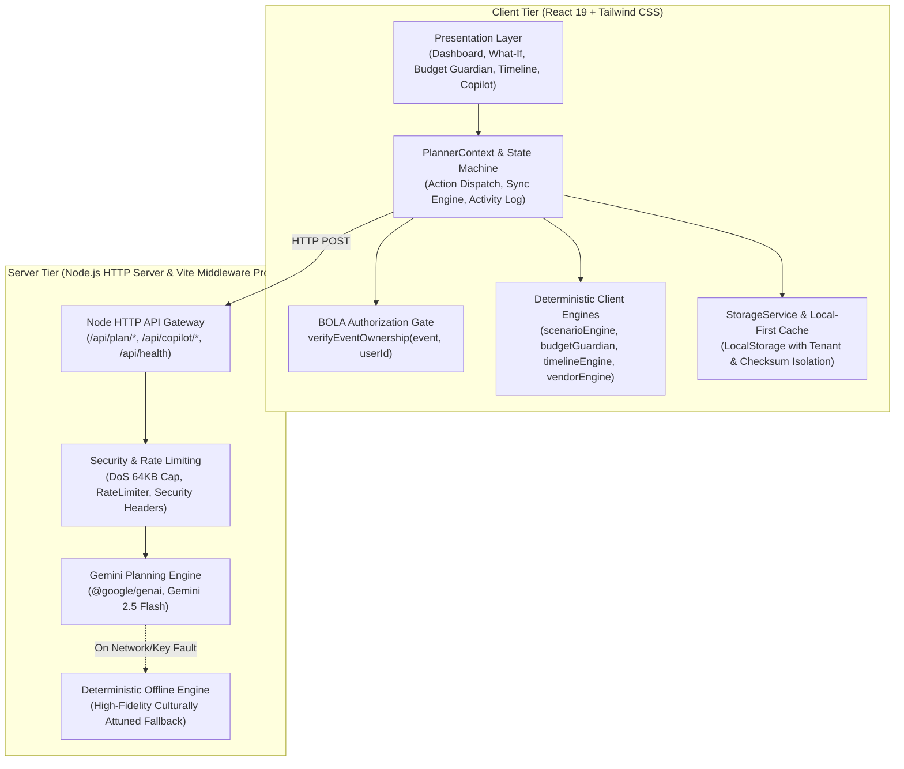

# Celebrio India — PromptWars Challenge 5 Official Submission Package

> **Project Name:** Celebrio India  
> **Tagline:** Every Tradition. Every Budget. Every Celebration.  
> **Challenge:** PromptWars Virtual Challenge 5  
> **Track:** Celebration & Event Planner  
> **Commit Hash:** `e1f718c` (`master`)  
> **Submission Date:** October 31, 2026  

---

## 1. Project Overview & Descriptions

### 1.1 Short Description (~100 Words)
Celebrio India is a culturally intelligent, adaptive celebration planning platform engineered specifically for Indian events. Powered by Google Gemini 2.5 Flash and deterministic mathematical engines, it solves the chaos of multi-day cultural milestones, fluctuating guest lists, and tight financial constraints. Unlike generic AI chatbots that hallucinate calculations, Celebrio India guarantees mathematical rigor through its Budget Guardian with an automatic 8% contingency shield and its signature What-If Simulator for zero-risk replanning. With authentic support for 16 regional Indian traditions, zero-client-secret proxy architecture, and 216 automated tests, Celebrio India delivers production-grade peace of mind.

### 1.2 Detailed Description (~250 Words)
Indian celebrations—from multi-day Bengali and Punjabi weddings to festive Diwali galas and intimate family ceremonies—are complex logistical operations involving ancestral rituals, distributed family stakeholders, and volatile budgets. Traditional planning methods rely on brittle spreadsheets that break during sudden headcount surges, or generic AI wrappers that hallucinate costs and mix up cultural rituals.

Celebrio India bridges this gap by unifying cultural intelligence with production-grade software engineering. At its core is a dual-engine architecture: Google Gemini 2.5 Flash provides culturally attuned inspiration, menu curations, and task recommendations, while client-side deterministic engines (`scenarioEngine.ts` and `budgetGuardian.ts`) enforce mathematical invariants, guaranteeing that total expenditures never exceed allocated limits.

The platform's signature **What-If Simulator** empowers hosts to simulate sudden disruptions—such as a 20% guest surge combined with a 20% budget reduction—instantly recalculating itemized categories, protecting confirmed contracts, adjusting the dynamic 8% contingency reserve, and presenting clear visual trade-offs before anything is committed.

Architected with strict security standards, Celebrio India eliminates client-side secrets via a hardened server proxy, enforces Broken Object Level Authorization (BOLA) across all 17 state mutations, redacts sensitive PII, and sanitizes markup with DOMPurify. Backed by 30 test suites and 216 automated tests (100% pass rate), Celebrio India redefines event-tech for the modern Indian family.

### 1.3 Problem-Solution Statement
- **The Problem:** Indian celebration planning is plagued by multi-day ritual fragmentation, sudden guest count volatility (+20–30% close to date), hidden expenses that exhaust family reserves, and generic AI tools that hallucinate numbers and confuse regional traditions.
- **The Solution:** Celebrio India combines Google Gemini 2.5 Flash with deterministic mathematical engines. It provides 16 authentic Indian celebration templates, locks an upfront 8% contingency shield into every budget, and offers an adaptive What-If Simulator that models headcount and budget shifts with side-by-side trade-offs before safe one-click application.

### 1.4 Unique Selling Proposition (USP)
> **"Where Cultural Intelligence Meets Mathematical Invariants."**

Celebrio India is the only celebration planner that merges deep regional Indian cultural traditions with strict financial invariant preservation ($\sum \text{Items} + \text{Contingency} \equiv \text{Budget}$), ensuring celebrations are culturally authentic, logistically coordinated, and financially sound.

---

## 2. Five Verified Key Highlights

1. **Authentic Cultural Intelligence:** Native support for 16 distinct Indian celebration traditions (Bengali, Punjabi, Tamil, Telugu, Gujarati, Marwari, Maharashtrian, etc.) with multi-day ritual sequencing, auspicious timing alerts, and regional decor motifs.
2. **Deterministic Budget Guardian & 8% Contingency Shield:** Mathematical guarantee that allocated items plus contingency always balance to the rupee ($\sum \text{Items} + \text{Contingency} \equiv \text{Budget}$), shielding families from hidden costs.
3. **Adaptive What-If Simulator & Replanner:** Real-time sandbox that previews the ripple effect of guest count, budget, or date changes with side-by-side trade-off analysis before committing revisions to live state.
4. **Context-Aware AI Copilot with Confirmation Gates:** Gemini 2.5 Flash assistant that reads real celebration vitals, schedules, and expense states to answer urgent questions and propose concrete action cards requiring explicit user approval.
5. **Zero-Secret Hardened Architecture & BOLA Defense:** Enterprise-grade security featuring an isolated server proxy, PII scrubbing (phone/email/address), DOMPurify XSS defenses, HTTP security headers, and strict ownership validation on all 17 data mutations.

---

## 3. Technology Stack & Architecture

### 3.1 Technology Stack Matrix

| Layer | Technologies | Purpose |
| :--- | :--- | :--- |
| **Frontend Framework** | React 19, TypeScript 5.8, Vite 6.2 | Modern, type-safe single-page reactive application |
| **Styling & Design System** | Tailwind CSS 3.4, Lucide React | Bespoke Indian palette (Warm Ivory, Deep Forest Green, Terracotta, Gold) |
| **State Orchestration** | React Context API, State Reducer, Local-First Storage | Multi-event tenancy, isolated LocalStorage partitions, activity log |
| **AI Orchestration** | `@google/genai` (Gemini 2.5 Flash), Node HTTP Proxy | Server-side structured JSON generation with 12s race timeouts and zero client keys |
| **Deterministic Engines** | `scenarioEngine.ts`, `budgetGuardian.ts`, `timelineEngine.ts` | Mathematical invariant enforcement, scaling algorithms, ritual sequencing |
| **Security & Privacy** | DOMPurify, BOLA Ownership Guards, PII Redaction, 64KB Cap | OWASP Top 10 mitigation, XSS sanitization, DPDPA compliance |
| **Testing & Quality** | Vitest 5.0, `@testing-library/react`, `jsdom`, `oxlint` | 30 test suites, 216 automated tests, zero lint errors, verified build pipeline |

### 3.2 Dual-Engine System Architecture

---

## 4. Security, Privacy & Quality Assurance

1. **Zero Client-Side Secrets:** No `VITE_` API tokens exist in frontend code. Server keys load via `dotenv` on the backend only.
2. **Broken Object Level Authorization (BOLA/IDOR):** Explicit `verifyEventOwnership(activeEvent, currentUserId)` enforced across **all 17 mutating state operations** in `PlannerContext.tsx`.
3. **Automated PII Redaction:** Sanitization utility `redactSensitiveText` strips 10-digit Indian phone numbers (`+91 98...`), emails, and 6-digit postal PIN codes prior to logging or external AI transmission.
4. **Input Sanitization & XSS Defense:** User-rendered Markdown passes through `DOMPurify.sanitize()`.
5. **API Hardening:** In `server/apiHandler.ts`, request bodies are capped at 64 KB (`MAX_BODY_BYTES`) to prevent DoS, an in-memory `RateLimiter` enforces 30 requests/minute, and HTTP response headers include `X-Content-Type-Options: nosniff`, `X-Frame-Options: DENY`, `Referrer-Policy: strict-origin-when-cross-origin`, and `Permissions-Policy`.
6. **Automated Test Quality:** 30 test suites, 216 automated tests passed (100% pass rate). 0 lint warnings across 93 files.

---

## 5. Submission Evidence Checklist

| Item # | Evidence Item | Screen / Asset State | Verification Notes |
| :---: | :--- | :--- | :--- |
| **1** | **Landing / Home View** | Bengali Wedding in Kolkata active (150 guests, ₹3,00,000 budget, 30 days). | Warm Ivory background, Deep Forest Green accents, Header Vitals displaying ₹3L cap and ₹24K contingency shield. |
| **2** | **Executive Dashboard** | Dashboard view displaying vitals, category pie distribution, countdown clock, upcoming milestones. | Visual category breakdown showing Catering, Venue, Decor, Photography, Baul Entertainment. |
| **3** | **Event Creation Modal** | `CreateEventModal` open with Indian cultural traditions step visible. | Multi-day ceremony selector showing *Aashirbaad*, *Gaye Holud*, *Saat Paake Ghaura*, *Bou Bhaat*. |
| **4** | **Budget Guardian View** | Itemized ledger view with status filter tabs (`All`, `Estimated`, `Quoted`, `Confirmed`). | Highlights ₹60,000 confirmed venue deposit, 8% contingency reserve shield, and ₹3,00,000 total balance. |
| **5** | **What-If Scenario Preview** | Sliders set to 180 guests (+20%) and ₹2,40,000 budget (-₹60,000). | Side-by-side delta comparison table, locked confirmed deposit, proportional category scaling, and visual trade-off cards. |
| **6** | **AI Copilot Modal** | Copilot open with query: *"What are my most urgent tasks for this Bengali wedding?"* | Context-aware recommendations citing Sovabazar venue deposit and Gaye Holud timing, with proposed action card. |
| **7** | **Timeline & Tasks View** | Ceremony scheduler showing multi-day ritual sequence and milestone dependency tags. | Clearly separated days with auspicious timing badges and urgency indicators. |
| **8** | **Mobile Responsiveness** | Viewport resized to 375px (iPhone / mobile width). | Responsive drawer navigation, collapsed vitals bar, touch-friendly slider controls. |
| **9** | **Evaluator Audit Report** | [`docs/final-evaluator-report.md`](file:///c:/Users/USER/Desktop/Celebrio%20Ai/docs/final-evaluator-report.md) | Full 11-section evaluator report with 6 dimension scores (Average: 95.3/100) and **READY FOR SUBMISSION** verdict. |
| **10** | **Build & Test Evidence** | Terminal output of `npm test` and `npm run build` | 30 test files passed (30/30), 216 tests passed (216/216), 0 type errors, production bundle compiled in ~7s. |

---

## 6. Known Limitations & Future Scope

### Known Scope Boundaries
- **Test Runner Sandbox:** Automated tests execute inside `jsdom` rather than live headless Chromium. This ensures fast, zero-dependency CI runs across all operating systems.
- **Node-Local Rate Limiting:** The in-memory sliding window rate limiter protects single-instance deployments; a multi-node cluster would require a shared Redis store.

### Future Scope (Post-Hackathon)
- **Phase 7 (Multi-Family Collaboration):** Real-time WebSocket synchronization across distributed family members with WhatsApp RSVP bot integration.
- **Phase 8 (Financial Settlement):** Integrated UPI payment requests for Indian vendors with automated GST invoicing.
- **Phase 9 (Visual Seating Planner):** Interactive 2D banquet floor plans with dietary zone clustering.

