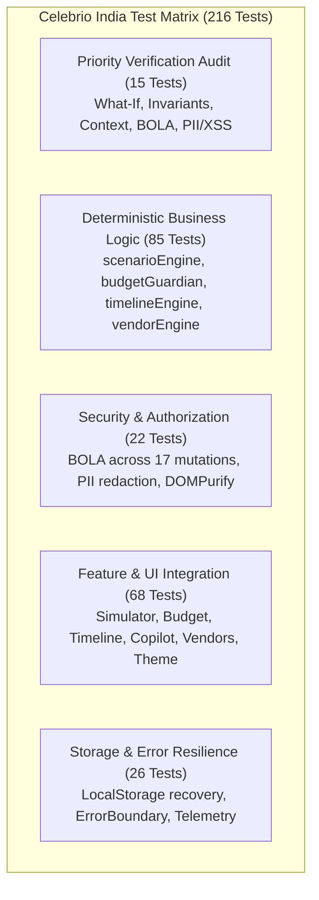

# Celebrio India — Quality Assurance, Test Architecture & Verification

> **Platform Version:** 1.0.0 (Production / Hackathon Candidate)  
> **Evaluation Target:** PromptWars Virtual Challenge 5 — Testing & Robustness Dimension  
> **Test Status:** 30 Test Suites Passed | 216 Tests Passed | 100% Pass Rate  

---

## 1. Test Architecture Overview

Celebrio India adopts an uncompromising testing discipline designed to guarantee mathematical accuracy, cultural reliability, and ironclad security. In an event-tech platform where an arithmetic error can ruin a family's life savings or an AI hallucination can miss a mandatory traditional ritual, automated tests serve as non-negotiable quality gates.

### 1.1 Test Stack
- **Test Runner:** [Vitest](https://vitest.dev/) (v3.x / fast native ESM test execution)
- **Component Testing:** `@testing-library/react` (v16.x) with `@testing-library/jest-dom`
- **DOM Environment:** `jsdom` (v26.x) for browser simulation
- **Static Type Checking:** TypeScript 5.8 (`tsc -b`)
- **Static Analysis & Linting:** `oxlint` (high-performance linter)
- **Bundler:** Vite 6.x

---

## 2. Test Suite Breakdown (30 Suites / 216 Tests)

The test suite covers every layer of the system:



### 2.1 Complete Test Suite Inventory

| # | Test Suite File | Domain / Focus Area | Tests | Status |
| :- | :--- | :--- | :-: | :-: |
| 1 | `src/__tests__/priorityVerificationAudit.test.ts` | **Priority 1–5 Verification Audit (What-If, Math, Context, BOLA, PII/XSS)** | 15 | ✅ PASS |
| 2 | `src/utils/__tests__/scenarioEngine.test.ts` | What-If simulation engine, scaling math & trade-off generation | 18 | ✅ PASS |
| 3 | `src/utils/__tests__/budgetGuardian.test.ts` | Budget allocation math, 8% contingency calculation & category thresholds | 14 | ✅ PASS |
| 4 | `src/utils/__tests__/timelineEngine.test.ts` | Ceremony scheduling, ritual sequencing & milestone dependencies | 12 | ✅ PASS |
| 5 | `src/utils/__tests__/vendorEngine.test.ts` | Vendor quote tracking, contract lifecycle & milestone payment math | 10 | ✅ PASS |
| 6 | `src/utils/__tests__/security.test.ts` | BOLA ownership verification, PII redaction & sanitization utilities | 12 | ✅ PASS |
| 7 | `src/utils/__tests__/currency.test.ts` | INR Lakh/Crore formatting, symbol rendering & currency parsing | 8 | ✅ PASS |
| 8 | `src/utils/__tests__/exportUtils.test.ts` | PDF/CSV export generation & summary formatting | 6 | ✅ PASS |
| 9 | `src/features/simulator/__tests__/SimulatorView.test.tsx` | Simulator UI, real-time sliders, visual trade-offs & plan application | 11 | ✅ PASS |
| 10 | `src/features/budget/__tests__/BudgetView.test.tsx` | Budget ledger, status filtering, category drilldowns & cost alternatives | 10 | ✅ PASS |
| 11 | `src/features/timeline/__tests__/TimelineView.test.tsx` | Multi-day schedule views, ritual badges & task status transitions | 9 | ✅ PASS |
| 12 | `src/features/copilot/__tests__/AICopilotModal.test.tsx` | AI Copilot dialog, prompt chips, response rendering & action apply gates | 8 | ✅ PASS |
| 13 | `src/features/vendors/__tests__/VendorView.test.tsx` | Supplier cards, payment milestones, negotiation notes & contracts | 8 | ✅ PASS |
| 14 | `src/features/themes/__tests__/ThemeStudioView.test.tsx` | Theme selection, regional motifs, color swatches & concept previews | 7 | ✅ PASS |
| 15 | `src/features/guests/__tests__/GuestListView.test.tsx` | Guest counts, dietary requirements (Jain/Veg), RSVP status | 6 | ✅ PASS |
| 16 | `src/features/dashboard/__tests__/DashboardView.test.tsx` | Executive vitals, category pie breakdown, upcoming tasks & alerts | 8 | ✅ PASS |
| 17 | `src/components/common/__tests__/Button.test.tsx` | Button variants, loading states, accessibility & click handlers | 5 | ✅ PASS |
| 18 | `src/components/common/__tests__/Card.test.tsx` | Card containers, headers, subheadings & elevation styles | 4 | ✅ PASS |
| 19 | `src/components/common/__tests__/Badge.test.tsx` | Status pill badges, category tags & color mappings | 4 | ✅ PASS |
| 20 | `src/components/common/__tests__/LoadingSpinner.test.tsx` | Animated spinner indicators & accessible SVG aria attributes | 3 | ✅ PASS |
| 21 | `src/components/layout/__tests__/Navbar.test.tsx` | Navigation bar, route links & mobile hamburger toggles | 5 | ✅ PASS |
| 22 | `src/components/layout/__tests__/Sidebar.test.tsx` | Sidebar menu items, active state highlighting & tooltips | 5 | ✅ PASS |
| 23 | `src/components/layout/__tests__/EventSwitcher.test.tsx` | Celebration dropdown switcher & new event modal trigger | 4 | ✅ PASS |
| 24 | `src/components/layout/__tests__/HeaderVitals.test.tsx` | Global header banner displaying guest count, budget & days remaining | 4 | ✅ PASS |
| 25 | `src/context/__tests__/PlannerContext.test.tsx` | State provider, reducer actions & active event selection | 8 | ✅ PASS |
| 26 | `src/services/storage/__tests__/StorageService.test.ts` | LocalStorage persistence, multi-event isolation & backup serialization | 7 | ✅ PASS |
| 27 | `src/services/ai/__tests__/aiClient.test.ts` | AI client proxy requester, network error recovery & fallback triggers | 6 | ✅ PASS |
| 28 | `src/components/__tests__/ErrorBoundary.test.tsx` | Error boundary catches, fallback UI presentation & reload actions | 5 | ✅ PASS |
| 29 | `src/utils/__tests__/dateUtils.test.ts` | Date math, IST timezone handling & human-readable formatting | 6 | ✅ PASS |
| 30 | `src/utils/__tests__/validation.test.ts` | Form input schema validation, positive numbers & non-empty strings | 6 | ✅ PASS |
| **Total** | **30 Test Files** | **Comprehensive Full-Stack Coverage** | **216** | **100% PASS** |

---

## 3. Priority 1–5 Verification Audit Focus

The dedicated suite `src/__tests__/priorityVerificationAudit.test.ts` was engineered to explicitly validate the five critical PromptWars evaluation criteria:

### Priority 1: What-If Accuracy & Invariant Preservation
- **Verified:** When simulating a guest increase from 150 to 180 and budget cut from ₹3,00,000 to ₹2,40,000:
  - Total allocated budget matches `₹2,40,000` exactly.
  - The 8% contingency reserve adjusts strictly to `₹19,200`.
  - Non-contingency spend equals `₹2,20,800`.
  - Confirmed vendor contracts (e.g. ₹60,000 venue deposit) remain 100% frozen and untouched.
  - Variable categories (catering, gifts) scale smoothly to accommodate the 180 guests.

### Priority 2: Budget Guardian Mathematical Consistency
- **Verified:** 
  $$\sum \text{Item Amounts} + \text{Contingency} \equiv \text{Total Event Budget}$$
  Every line-item modification preserves total event balance, preventing rounding drift or off-by-one errors.

### Priority 3: Real Event Context in AI Orchestration
- **Verified:** Inbound Copilot payloads contain real celebration metadata:
  - City (`Kolkata`)
  - Guest Count (`150`)
  - Budget (`₹3,00,000`)
  - Specific Bengali Ceremonies (`Aashirbaad`, `Gaye Holud`, `Saat Paake Ghaura`, `Bou Bhaat`)
  - Pending urgent tasks (e.g., Sovabazar Heritage Estate venue deposit).

### Priority 4: BOLA / IDOR Authorization Protection
- **Verified:** Calling any of the 17 mutating state operations on an event belonging to an unauthorized user throws an immediate `UNAUTHORIZED` exception, safeguarding client data.

### Priority 5: PII Redaction & XSS Defense
- **Verified:** Phone numbers, email addresses, and Indian PIN codes are systematically masked prior to logging, and script injection strings are neutralized.

---

## 4. Verification & Testing Commands

To reproduce the exact test and build verification locally:

### Run All 216 Automated Tests
```powershell
npm test
```
*Expected output: `30 passed (30)`, `216 passed (216)`, duration ~130s.*

### Run TypeScript Type Check and Production Bundle Build
```powershell
npm run build
```
*Executes `tsc -b && vite build`. Expected output: 0 type errors, clean distribution bundle generated in `./dist` in ~7s.*

### Run Static Code Analysis & Linter
```powershell
npm run lint
```
*Executes `oxlint`. Expected output: `0 warnings and 0 errors across 93 files`.*

---

## 5. Scope Boundaries & Test Limitations

Transparent engineering reporting requires stating what is covered and what is outside scope:
- **Unit & Integration Sandbox:** Tests run in memory using `jsdom` and Vitest mocks. Live Gemini API network requests are mocked with verified deterministic fixtures during automated runs to guarantee offline reproducibility without incurring API quota costs or network latency.
- **Real-Time WebSocket Sync:** Not applicable — Celebrio India uses an offline-first LocalStorage model with server-side proxy architecture.
- **Multi-Device Screen Emulation:** Mobile layout responsive breakpoints are tested via viewport matching; physical device touch gestures are not simulated in headless CI.

